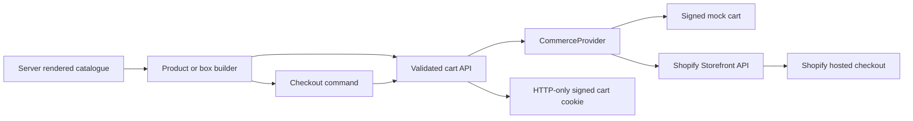
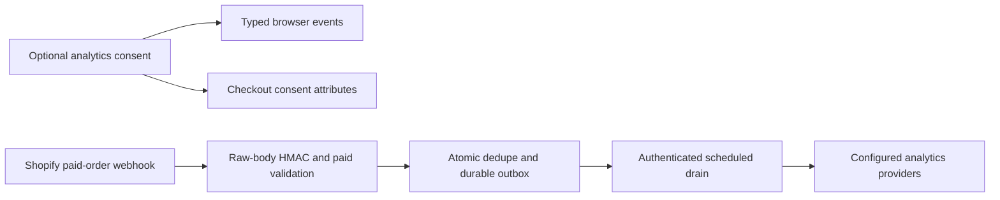

# Architecture

STILLA is a modular Next.js App Router application built for a catalogue of roughly ten products. The working name and fictional seed content can be replaced without changing the commerce interfaces.

## Boundaries

| Boundary                    | Modules                                                                       | Responsibility                                                                    |
| --------------------------- | ----------------------------------------------------------------------------- | --------------------------------------------------------------------------------- |
| Routes and server rendering | `src/app/[locale]/`, `src/lib/seo/`                                           | Localized pages, catalogue reads, metadata and structured data                    |
| Presentation                | `src/components/`                                                             | Layout, product views, forms, consent, accessible drawer and cinematic interface  |
| Interactive domains         | `src/features/cart/`, `box-builder/`, `seasonal-experience/`                  | Cart commands, box rules/persistence, scene progress/media abstraction            |
| Commerce                    | `src/types/commerce.ts`, `src/lib/commerce/`                                  | Provider contract, runtime validation, cookies, errors and Shopify/mock adapters  |
| Editorial content           | `src/types/content.ts`, `src/lib/content/`, `src/content/`                    | Seasons, curated templates, translations and repository contract                  |
| Analytics/privacy           | `src/lib/analytics/`, consent/analytics components                            | Event schema, consent, optional browser adapters, attribution and purchase outbox |
| Security/operations         | `src/lib/security/`, `src/lib/env/`, `src/proxy.ts`, `src/instrumentation.ts` | Request boundaries, secrets, rate limits, idempotency, CSP and redacted reporting |

Server-rendered pages use provider-neutral `Product`, `Collection`, `Season` and `GiftBoxTemplate` objects. Client code does not import commerce credentials. Interactions cross validated same-origin API routes. Prices remain numeric major SEK units at the boundary; money helpers use integer öre for arithmetic.

## Shopping flow

`CommerceProvider` covers catalogue/collection reads, cart creation/retrieval/mutations, attributes, availability and checkout URL creation. `getCommerceProvider()` chooses one adapter after environment validation. Development defaults to mock; production mock usage requires explicit opt-in. No production configuration error silently swaps Shopify for mock data.

Mock carts store a size-limited, HMAC-signed compact cart representation in an HTTP-only cookie. Shopify carts use a signed reference instead. Cookies expire after seven days, use SameSite=Lax, and are Secure in production. These are signed integrity protections, not encryption. Do not use mock cart storage for production customer data. Changing the signing key invalidates existing carts.

The cart API validates proposed changes against a freshly loaded catalogue and availability before mutation. Bundle lines carry `bundle_id`, `bundle_role` and `box_size`; optional plain-text `gift_message` belongs to the packaging line. Updating/removing a grouped bundle affects its related lines. Reconfiguration validates the whole replacement and creates a fresh provider cart with retained attributes. Shopify remains authoritative for final inventory, price, shipping, taxes and payment.

The client serializes mutation requests and disables duplicate checkout submissions. Server validation remains authoritative. This is not a general distributed mutation-idempotency system; review retry behavior if adding background cart writes or multiple active devices.

## Builder and content

`BOX_RULES` defines small/large limits. A valid box has packaging, one signature product, two extras for the small box or two to three for the large, and an optional card. Products must be available, eligible for the box and active season, and in the expected category. User text is length-limited, normalized and sanitized, then rendered as text.

`ContentRepository` separates seasonal storytelling from Shopify's product system. The local adapter serves winter and three curated templates. A future CMS adapter should fetch and validate the same `Season`/template shapes, resolve product handles through `CommerceProvider`, reject broken references at publication, and provide preview/published state and cache invalidation. Keep provider product IDs, stock and pricing in commerce.

Translations and brand settings are centralized. The first release supports Swedish and English with SEK; adding a locale or currency requires coordinated types, route validation, dictionaries, provider markets and price-formatting changes. The model is extensible, but does not currently provide arbitrary currencies.

## Cinematic enhancement

Typed scenes define localized HTML copy, responsive posters/videos and normalized hotspot coordinates. `useSceneMedia` suppresses video for reduced motion, Save-Data and slow connections, lazily loads current/imminent assets, and installs scroll/rAF work only while the scene is visible. Sticky scrolling maps progress through `MediaScrubber`; the initial renderer seeks an HTML video. A sequence/canvas implementation can replace that adapter.

No video is required to browse or buy. Missing media keeps static scenes and conventional product/shop links. An accessible Radix drawer freezes media progress, shows product variants/stock, traps focus, closes on Escape and restores its opener. See [cinematic media](cinematic-media.md).

## Consent and confirmed purchases

Necessary cart/builder functions work without optional consent. GA4 and PostHog are disabled until analytics consent. The event schema allowlists properties; names, emails, addresses and gift messages do not enter analytics. First/last attribution is captured only after consent.

Only a correctly signed Shopify `orders/paid` payload from the configured shop, with paid state, a non-test order and consented checkout attributes, may queue `purchase`. Enqueue and order dedupe are atomic in Redis. The authenticated worker checkpoints each provider, retains failed work and uses stable IDs. External delivery is at least once; operations must reconcile provider reports. The browser and mock checkout cannot create purchase events.

## Security, rendering and operations

Environment validation identifies invalid field names without disclosing values. Public mutations enforce same-origin requests, JSON/body limits, strict schemas and rate limits. Development counters/idempotency records are process-local. Production requires the configured durable Redis REST service and fails closed without it. Form delivery uses an idempotency-keyed adapter and a honeypot, not a configured CRM.

Per-request CSP nonces require dynamic, non-shared HTML rendering. Shopify product images use its CDN allowlist. A new media/analytics provider requires an intentional CSP review. Secure headers and error boundaries are independent of optional analytics.

The health endpoint confirms configuration/liveness rather than remote dependency readiness. Error reporting defaults to redacted structured logs. `registerErrorReporter` is a seam for a reviewed Sentry SDK installation. See [security](security.md), [privacy](privacy.md) and [deployment](deployment.md).

## Verification and scaling choices

Vitest tests domain rules, adapters and interactive components. Playwright covers core shopping, consent, reduced motion, keyboard and automated accessibility checks. CI also checks formatting, lint, types, build and dependency vulnerabilities. Test services are mocks; real Shopify and delivery integration acceptance tests remain a launch gate.

The application deliberately avoids a microservice catalogue, custom payment fields, a CMS admin, WebGL and fulfilment orchestration. Current provider catalogue pagination is bounded, cart inputs/cookies are size-limited, and authenticated outbox batches are finite. Before scaling beyond the initial shop, add measured catalogue caching, operational metrics, queue prioritization/retention, live-provider contract tests and a reviewed content publication workflow.
