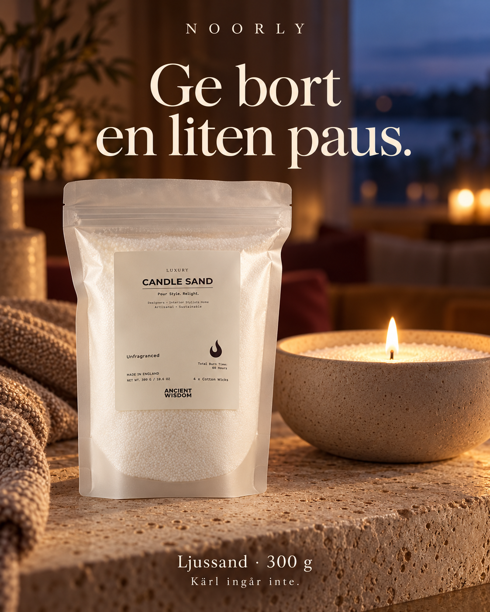
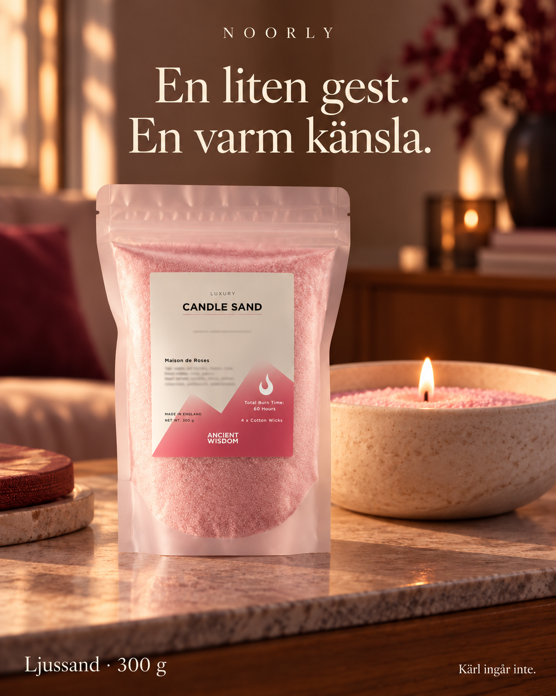
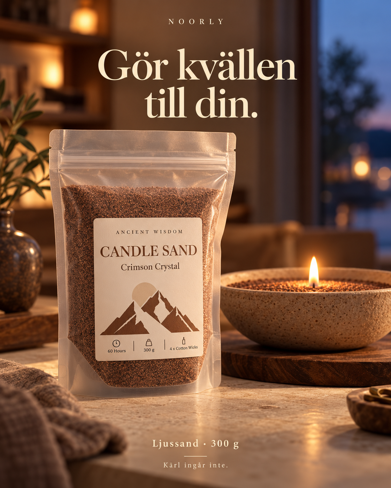
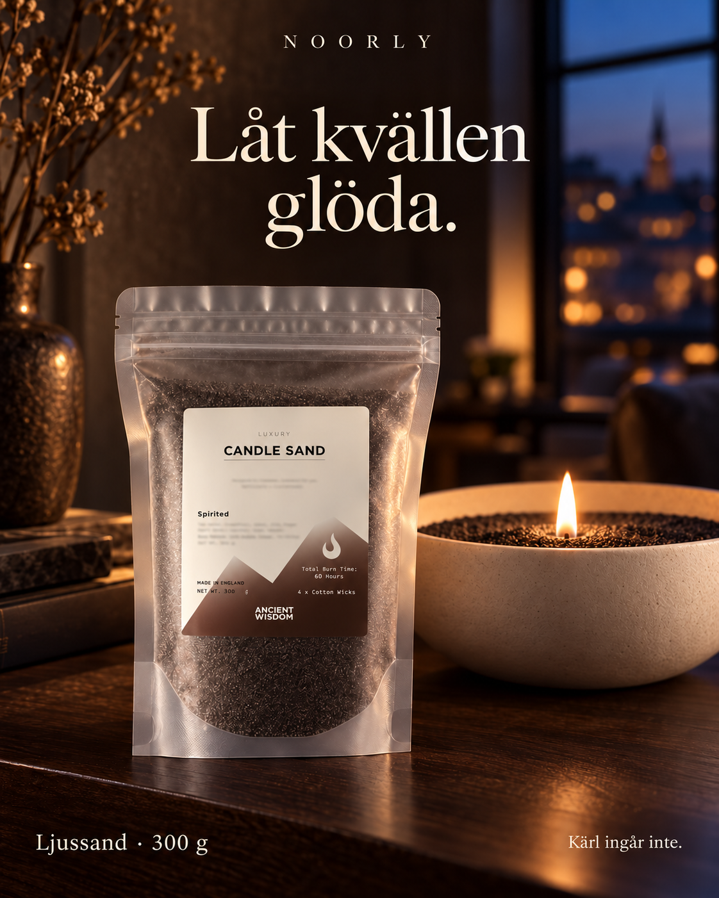
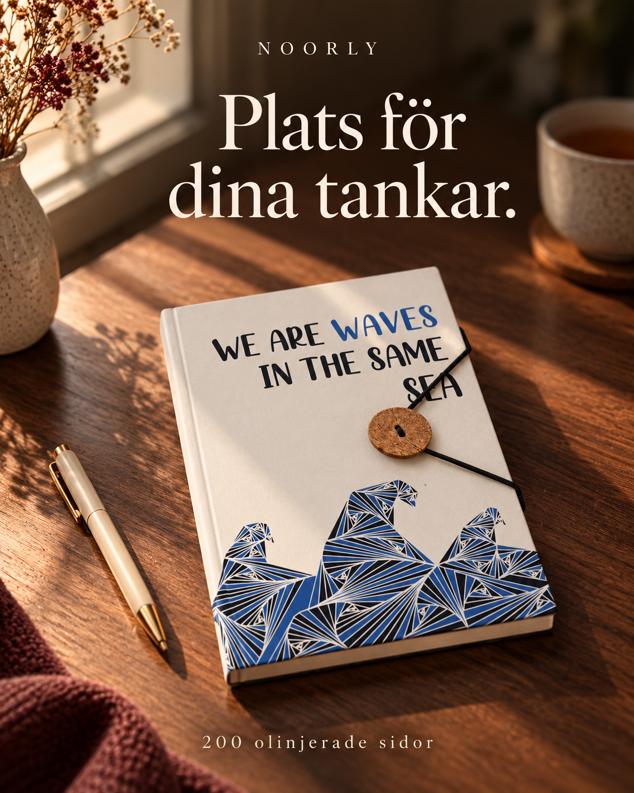
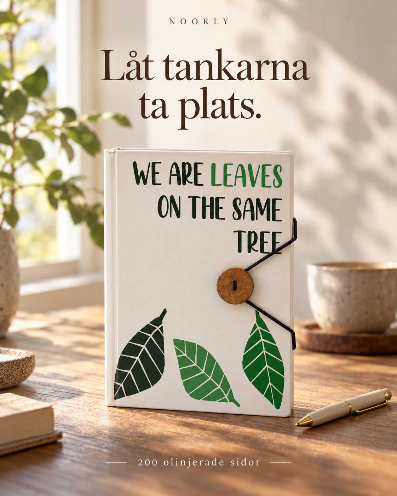
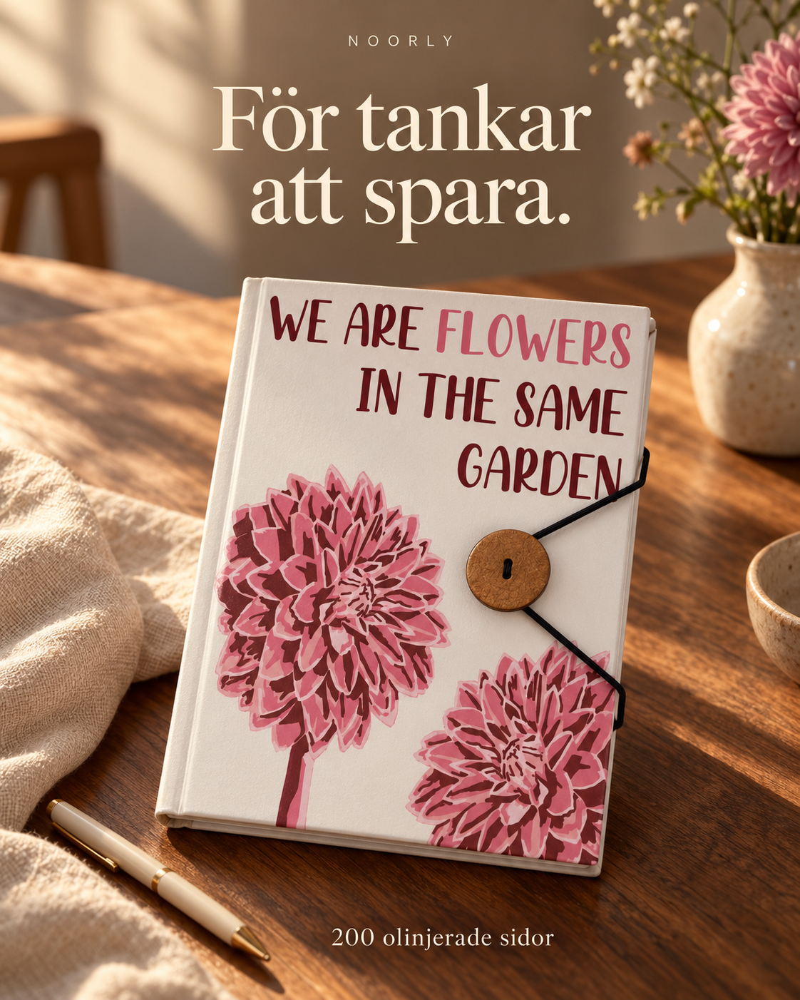
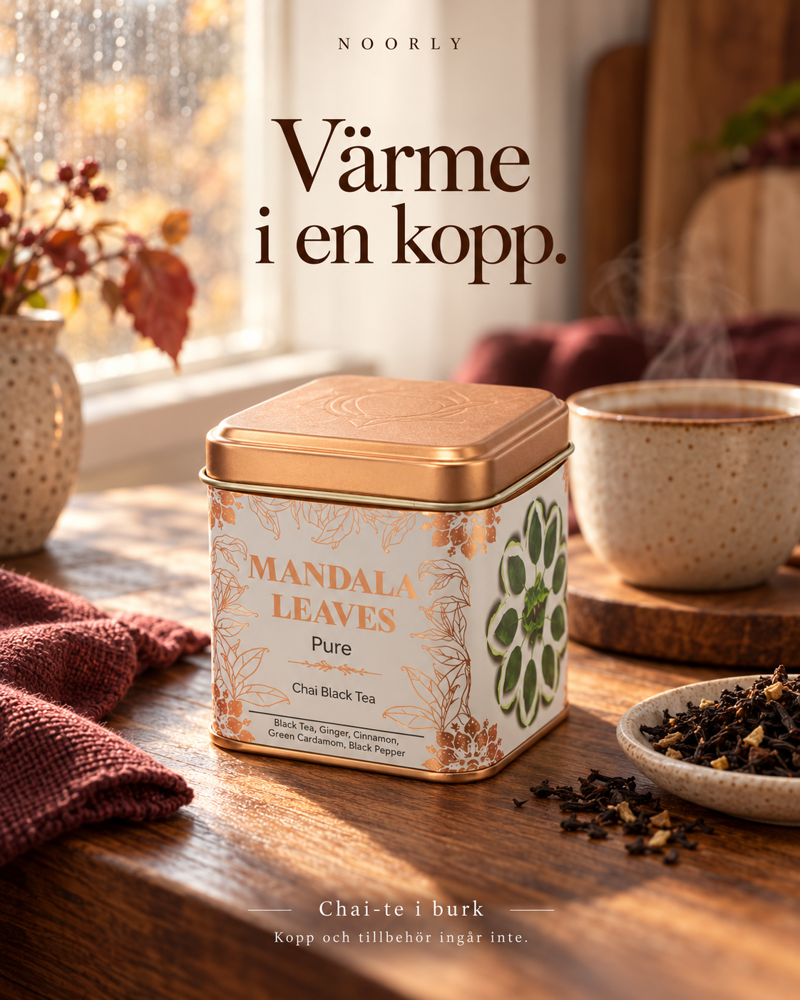

# Noorly image-ad drafts

Created 19 October 2026. Eight image concepts are saved: the two initial remakes and six additional concepts. Six are saved as Meta creative-library candidates with Swedish copy; mocha and chai are held as described below. No campaign or ad has been activated, and no additional media budget is allocated.

## Campaign use

Use the current paused Sales campaign 120251947281020015 and Purchase ad set 120251947284140015. Its DAILY campaign budget is 50 SEK shared by the whole campaign. Test one product at a time. The 4,000 SEK is the entire research reserve, not a per-product or per-creative allocation. Review the first product after roughly four to five days (about 200–250 SEK planned spend). This allowance is not an enforced cap: Meta daily budgets can vary, the campaign cap minimum here is 1,000 SEK, and no account-level limit has been set. A 4,000 SEK campaign spending ceiling protects the entire multi-product program, separate from its 50 SEK daily budget. See [current budget plan](meta-product-test-budget.md). The previous Sales and Leads campaigns/ad sets are archived.

The copy below describes the products without inventing prices, discounts, availability or delivery. A real paid pre-order offer, checkout and verified terms must be in place before activation. See [paid pre-order plan](paid-preorder-test.md).

The suggested destination URLs retain variant IDs, but the current product page does not select variants from its query string. Wire and verify that before activating a variant-specific ad. Do not send paid traffic to an unmatched default colour or the closed interest flow.

## AI editing and draft state

These are AI-edited lifestyle scenes based on supplier references. Vessels, cups, flowers, pens and furnishings are styling props, not included products. Candle images state that the vessel is not included.

Meta's optional `self_ai_disclosure` declaration remains unset for the merchant to choose: `OPT_IN` declares AI-edited media; `OPT_OUT` declares otherwise. No choice is inferred. Decide before launch; a later change may require rebuilding a creative. A creative-library object with ACTIVE status is an available asset, not a delivering ad.

Meta previously rejected ad attachments because billing lacked a valid payment method. Do not retry unchanged until billing is fixed. Saving copy or a creative-library object does not attach an ad to the campaign.

## Draft copy and imagery

### Ljussand · Vit · Doftfri

- Status: CREATIVE_DRAFT.
- Headline: Ge bort en liten paus.
- Primary text: Ge bort en liten paus. Vit, doftfri ljussand för en stilla stund. En påse med 300 g och fyra bomullsvekar. Kärl och dekorationer ingår inte.
- Proposed button: Läs mer / LEARN_MORE.
- Proposed destination: https://noorly-gifting.vercel.app/sv/products/candle-sand?variant=candle-sand-11&utm_source=facebook&utm_medium=paid_social&utm_campaign=noorly_paid_test&utm_content=csand-11

### Ljussand · Gammalrosa · Maison de Roses

- Status: CREATIVE_DRAFT.
- Headline: En liten gest. En varm känsla.
- Primary text: En liten gest som säger att du tänker på någon. Gammalrosa ljussand med doften Maison de Roses. 300 g och fyra bomullsvekar. Kärl och dekorationer ingår inte.
- Proposed button: Läs mer / LEARN_MORE.
- Proposed destination: https://noorly-gifting.vercel.app/sv/products/candle-sand?variant=candle-sand-07&utm_source=facebook&utm_medium=paid_social&utm_campaign=noorly_paid_test&utm_content=csand-07

### Ljussand · Mockabrun · Crimson Crystal

- Status: HELD_PACKAGING_LIKENESS.
- Headline: Gör kvällen till din.
- Primary text: Varma toner för en lugnare kväll. Mockabrun ljussand med doften Crimson Crystal. 300 g och fyra bomullsvekar. Kärl och dekorationer ingår inte.
- Proposed button: Läs mer / LEARN_MORE.
- Proposed destination: https://noorly-gifting.vercel.app/sv/products/candle-sand?variant=candle-sand-01&utm_source=facebook&utm_medium=paid_social&utm_campaign=noorly_paid_test&utm_content=csand-01
- Hold: Generated label differs from supplier packaging. Scene concept only; do not attach to an ad.

### Ljussand · Svart · Spirited

- Status: CREATIVE_DRAFT.
- Headline: Låt kvällen glöda.
- Primary text: Mörka toner. Ett mjukt sken. Svart ljussand med doften Spirited för din egen stilla stund. 300 g och fyra bomullsvekar. Kärl och dekorationer ingår inte.
- Proposed button: Läs mer / LEARN_MORE.
- Proposed destination: https://noorly-gifting.vercel.app/sv/products/candle-sand?variant=candle-sand-09&utm_source=facebook&utm_medium=paid_social&utm_campaign=noorly_paid_test&utm_content=csand-09

### Anteckningsbok · Waves

- Status: CREATIVE_DRAFT.
- Headline: Plats för dina tankar.
- Primary text: För tankar, planer och sådant du vill komma ihåg. En anteckningsbok med vågmotiv, rem och 200 olinjerade sidor. En liten gåva med plats för något personligt.
- Proposed button: Läs mer / LEARN_MORE.
- Proposed destination: https://noorly-gifting.vercel.app/sv/products/notebook-with-strap?variant=pnb-01&utm_source=facebook&utm_medium=paid_social&utm_campaign=noorly_paid_test&utm_content=pnb-01

### Anteckningsbok · Leaves

- Status: CREATIVE_DRAFT.
- Headline: Låt tankarna ta plats.
- Primary text: Små idéer förtjänar också en egen plats. Anteckningsbok med lövmotiv, rem och 200 olinjerade sidor för ord, skisser och nya planer.
- Proposed button: Läs mer / LEARN_MORE.
- Proposed destination: https://noorly-gifting.vercel.app/sv/products/notebook-with-strap?variant=pnb-02&utm_source=facebook&utm_medium=paid_social&utm_campaign=noorly_paid_test&utm_content=pnb-02

### Anteckningsbok · Flowers

- Status: CREATIVE_DRAFT.
- Headline: För tankar att spara.
- Primary text: En plats för små minnen och stora idéer. Anteckningsbok med blommotiv, rem och 200 olinjerade sidor. Till någon du tänker på, eller till dig själv.
- Proposed button: Läs mer / LEARN_MORE.
- Proposed destination: https://noorly-gifting.vercel.app/sv/products/notebook-with-strap?variant=pnb-03&utm_source=facebook&utm_medium=paid_social&utm_campaign=noorly_paid_test&utm_content=pnb-03

### Chai-te i burk

- Status: HELD_SPECIFICATION.
- Headline: Värme i en kopp.
- Primary text: När dagen får gå lite långsammare. Svart chai-te med kryddor, i en dekorativ burk. Kopp och tillbehör på bilden ingår inte.
- Proposed button: Läs mer / LEARN_MORE.
- Hold: Supplier title and net-weight fields disagree; no storefront route yet.

## Holds

The mocha image has a redesigned product label. Keep it as a mood concept only; it must not be attached to an ad until the actual supplier packaging is restored. The chai supplier title and net-weight field disagree, and chai has no verified storefront route. Its image is an unlaunched concept only, with no added weight claim.

The manifest in [noorly-ad-drafts.json](noorly-ad-drafts.json) records the exact copy, identifiers and draft state. Product evidence remains in [candle research](candle-sand-research.md) and [assortment research](gift-box-assortment-2026-10.md).

## Meta read-back

Six creative-library objects were saved and read back with matching copy and image hashes. No ad entities were attached because the known billing issue remains unresolved. The two new notebook creatives completed processing and were read back as ACTIVE assets. ACTIVE on a creative does not mean an ad is running.

- csand-11: creative 2922042104824918, image 101c3e0e633e040a2e68ed991c88fa44.
- csand-07: creative 986399003786814, image 967a1b193a2d92e95399472d8d521ee7.
- csand-09: creative 1058778663792280, image 0a68b42ab31b95bfb13c9f88625346b3.
- pnb-01: creative 1192123979803846, image 48a906ab9170b8b674424d8d9298e53a.
- pnb-02: creative 1102976052634240, image a2a972694f46917f33082f515b28028a.
- pnb-03: creative 4144422845690993, image 68b069d5e8359213d4ae2bedc46d35ba.
